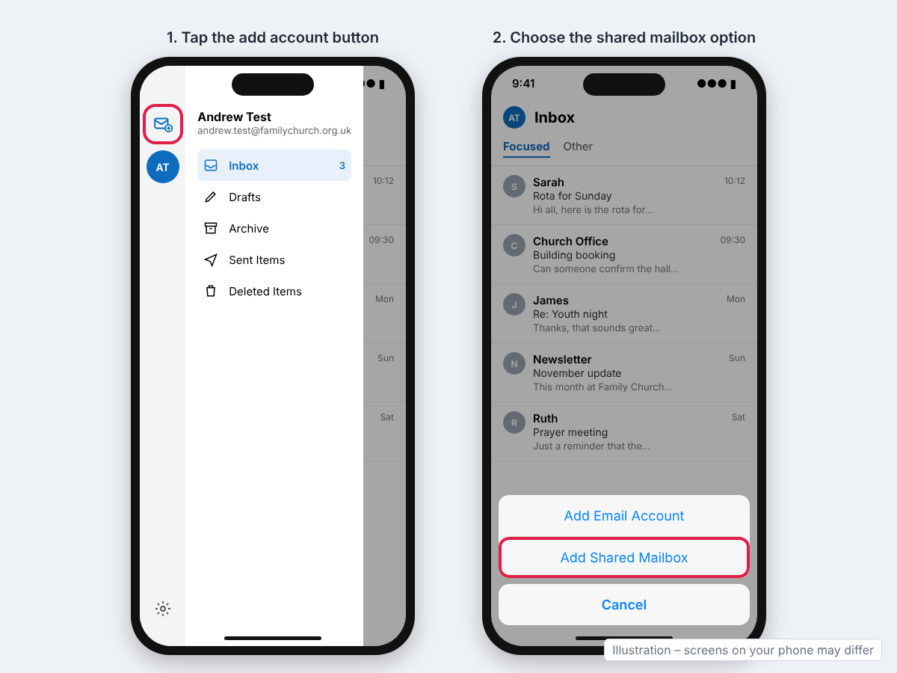
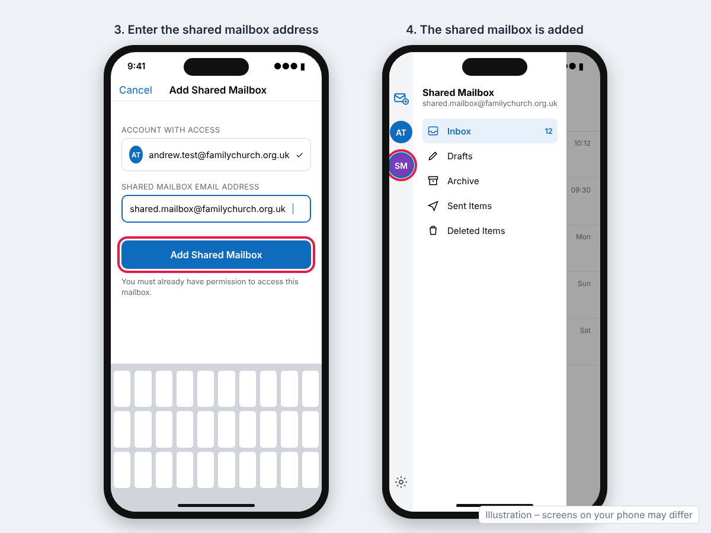
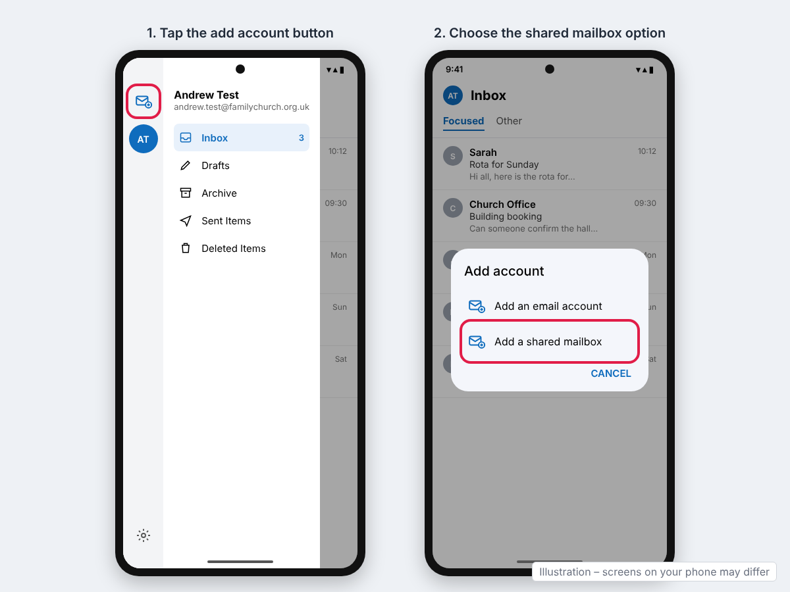
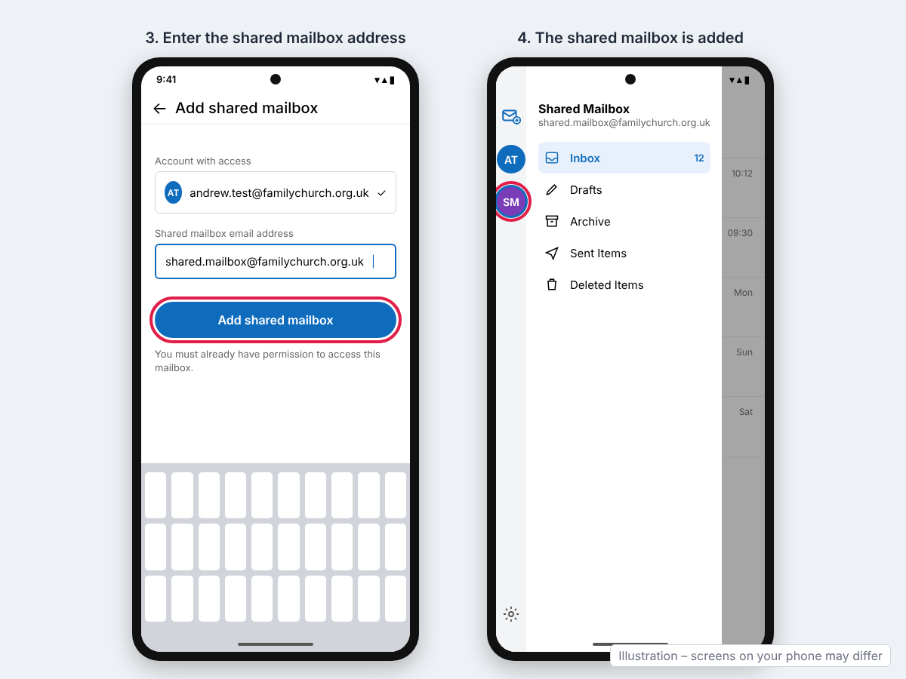
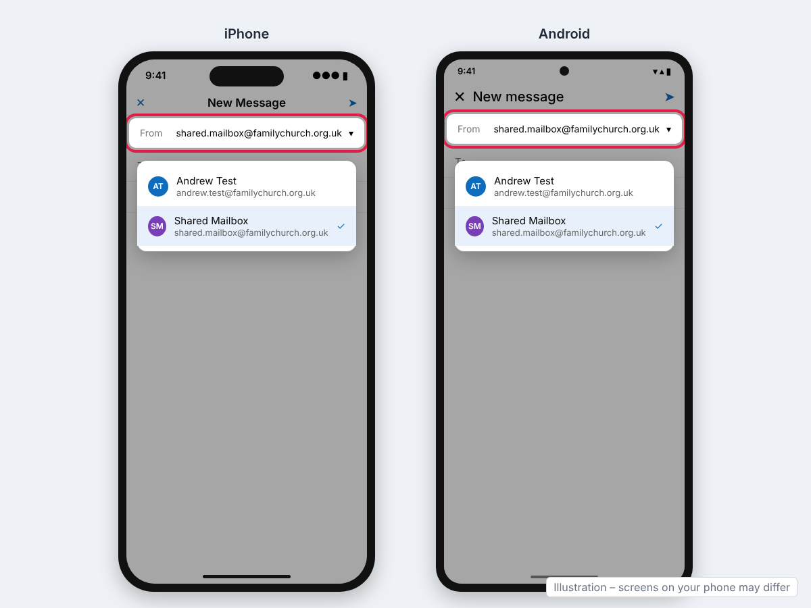

> **This guide will walk you through adding a shared mailbox to the Microsoft Outlook app on your mobile phone, so you can read and reply to the team inbox wherever you are**

## Introduction

If you haven't already, it's worth reading our guide on [how to access a Shared Mailbox](/shared-mailbox) first. It explains what a shared mailbox is, why Family Church uses them, and how to get to one on your computer.

Plenty of us check our email on our phones far more than on a computer, so it makes sense to have the shared mailbox there too. The good news is that the Outlook app on both iPhone and Android phones can add a shared mailbox in just a few taps.

## What you'll need

1. A Family Church Microsoft Account, set up with MFA. If you haven't done this yet, take a look at [how to access your Microsoft Account](/ms-account)
2. Permission to access the shared mailbox. If you think you need access to a mailbox, you should get in touch with the church board
3. The Microsoft Outlook app, from the App Store on an iPhone or the Google Play Store on an Android phone
4. The email address of the shared mailbox

> **Note that the images on this page are illustrations of the Outlook app, so the screens on your phone may look slightly different depending on your version of the app**

## Signing in to Outlook

The first step is to sign in to Outlook with **your** Family Church email address. If it is the first time you have opened the app, you will be asked to add an account. Enter your Family Church email address and password, and verify with MFA.

If you already use Outlook on your phone for another email account, such as a personal Gmail or Hotmail address, you will need to add your Family Church account as well. Follow the same steps below, but choose `Add Email Account` instead of `Add Shared Mailbox`.

Once you are signed in, you should see your Family Church mailbox.

> **Important to note that this is not the shared mailbox.**

## Adding the shared mailbox

>

With the Outlook app open, tap your profile picture or initials in the top left of the screen. This opens a side menu showing your folders, with a narrow column of icons down the left hand side.

At the top of that column is an envelope icon with a small plus sign. This is the `Add Account` button. Tap it, and a menu pops up from the bottom of the screen where the second option is `Add Shared Mailbox`.

You will now see a screen titled `Add Shared Mailbox`. If you have more than one account in Outlook, make sure your Family Church account is selected, as this is the account that has permission to access the mailbox.

Type in the email address of the shared mailbox and tap `Add Shared Mailbox`. After a few moments, the shared mailbox will appear as a new icon in the left hand column of the side menu, underneath your own account.

Tapping on the shared mailbox icon will switch to it. It appears as a completely separate inbox, and all emails sent to it will be separate to any emails sent to your Family Church email address. To get back to your own email, open the side menu again and tap your own account icon.



>

With the Outlook app open, tap your profile picture or initials in the top left of the screen. This opens a side menu showing your folders, with a narrow column of icons down the left hand side.

At the top of that column is an envelope icon with a small plus sign. This is the `Add Account` button. Tap it, and a menu pops up where the second option is `Add a shared mailbox`.

You will now see a screen titled `Add shared mailbox`. If you have more than one account in Outlook, make sure your Family Church account is selected, as this is the account that has permission to access the mailbox.

Type in the email address of the shared mailbox and tap `Add shared mailbox`. After a few moments, the shared mailbox will appear as a new icon in the left hand column of the side menu, underneath your own account.

Tapping on the shared mailbox icon will switch to it. It appears as a completely separate inbox, and all emails sent to it will be separate to any emails sent to your Family Church email address. To get back to your own email, open the side menu again and tap your own account icon.



## Sending from the shared mailbox

Thankfully, sending from the shared mailbox is a lot simpler on your phone than it is in a web browser. When you reply to an email while you are in the shared mailbox, Outlook will send the reply from the shared mailbox automatically.

When writing a brand new email, the `From` field at the top of the message shows which email address it will be sent from. Tap on it to open a list of your accounts, and pick the shared mailbox. This works the same way on both iPhone and Android.

**Always double check the `From` field before you tap send. It's very easy to reply to someone from your own email address by mistake, and then the rest of the team won't see the conversation**

## Removing the shared mailbox

If you no longer need the shared mailbox on your phone, for example if you are stepping down from a team, you can remove it. Tap your profile picture in the top left, then tap the cog at the bottom of the side menu to open `Settings`. Under the accounts section, tap on the shared mailbox and scroll to the bottom to find `Delete Account`.

This only removes the mailbox from your phone. To have your access removed altogether, get in touch with the church board.
